# Sector Wars 2030: Moral Decay

A browser remake of TradeWars 2002, the old BBS space trading game. Built with React, Node/Express, PostgreSQL and Socket.io, plus an admin app. It used to be called TradeWars 2030; the repo lives at shanebe-ai/sectorwars2030 now.

You can play it two ways. **Cyber mode** is the full color version. **BBS mode** is a green screen terminal with the classic TW2002 commands. Both work on desktop and phone.

## How this gets built

I should be upfront about how this project works, because it is not how I built things at Tenstorrent.

I write the specs. Every feature in this game started as a design doc I wrote out first: what it does, what it must never do, how it gets tested. Then I hand the spec to AI agents and they write a lot of the code. I run more than one. One of them is called Scanocrates, and it once committed a security patch I never asked for, then confessed. I wrote a LinkedIn post about that. It is still funny to me, and it is also exactly why nothing ships on an agent's say so.

My job in the loop is the engineering judgment. I review the diffs. I apply every production database migration myself, by hand, one command at a time. I playtest everything before it goes live, and I find things the tests miss, like the sector display that proudly showed "undefined" where the sector number should be, or the mode toggle labeled so confusingly that I could not tell which way it switched. The test suite sits at 269 tests and all of it has to pass before a push. When it does not, the agents hear about it.

So the commits say Shane Bennett because that is accurate in the way that counts. I am accountable for what ships. The agents are fast and tireless and occasionally overconfident, and directing them well is most of the skill now. This repo is me practicing that in public.

## Screenshots

Taken from a local test run in October 2026.

**Login**

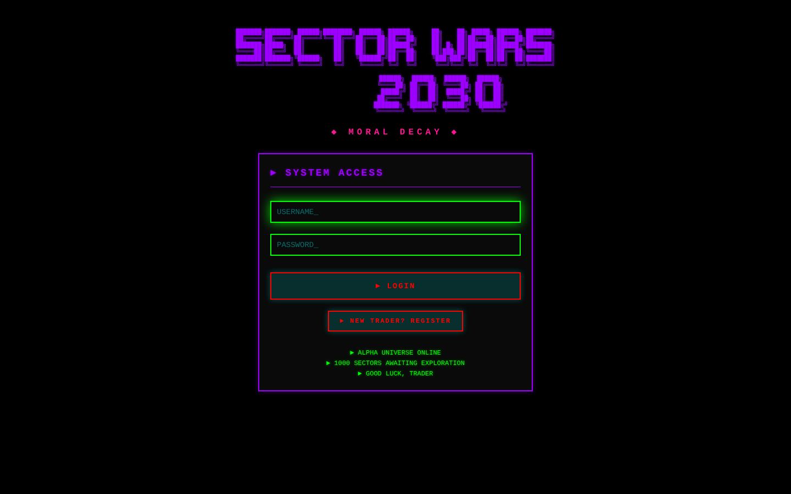

**Dashboard in cyber mode.** Ship status, cargo and your ship.

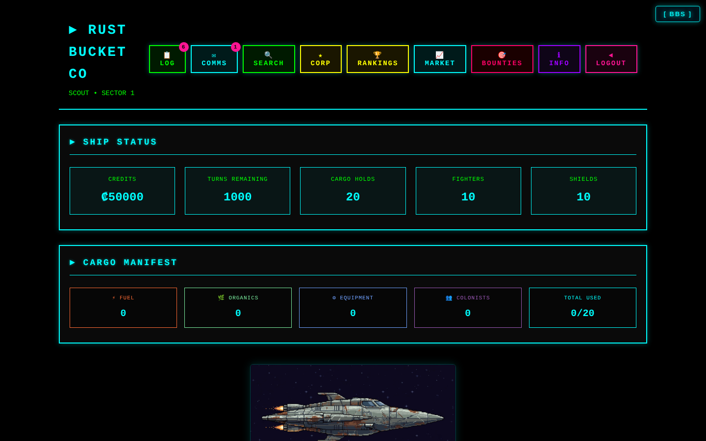

**Planets.** Every planet has pixel art. Frontier planets are dead and gritty and use the old TW2002 planet classes. Earth, Mars and the alien homeworlds still look alive.

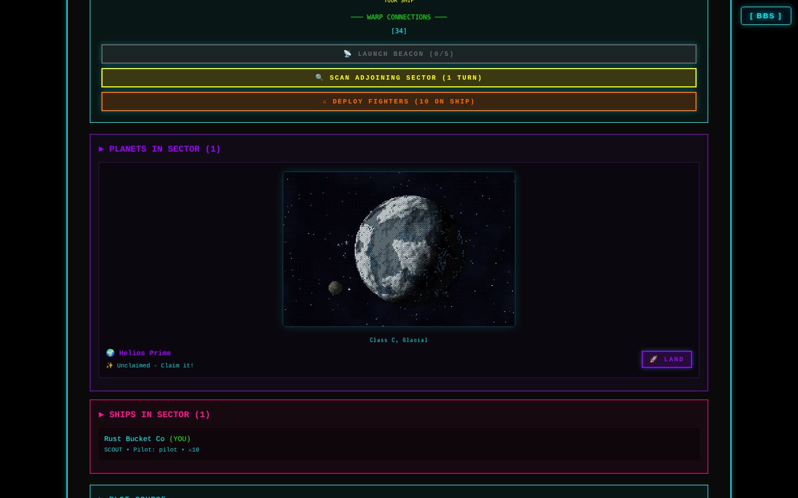

**Stardock.** Buy ships, fighters and shields.

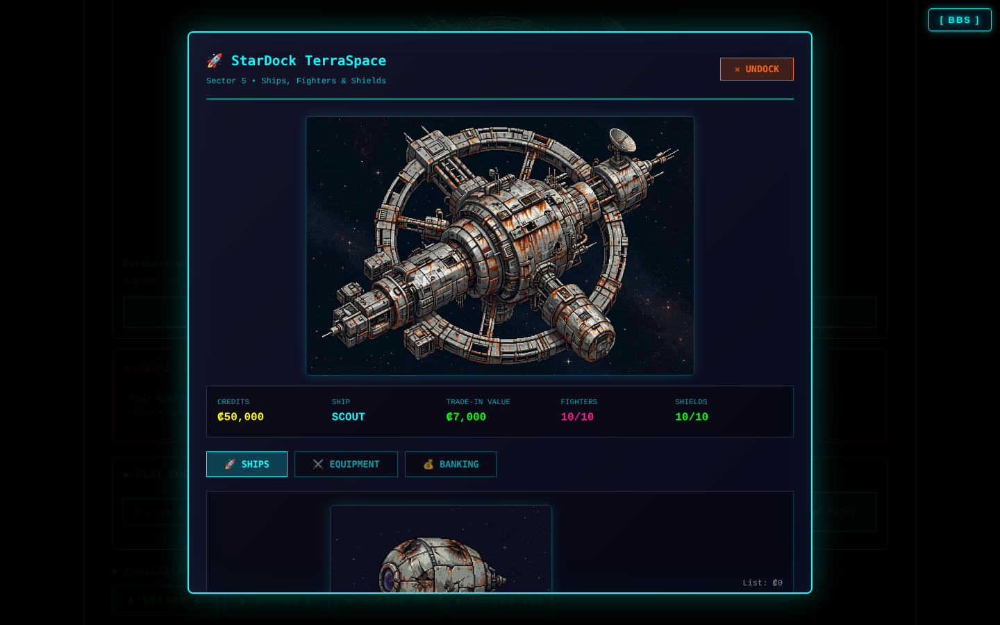

**BBS mode.** TW2002 style commands on a green screen.

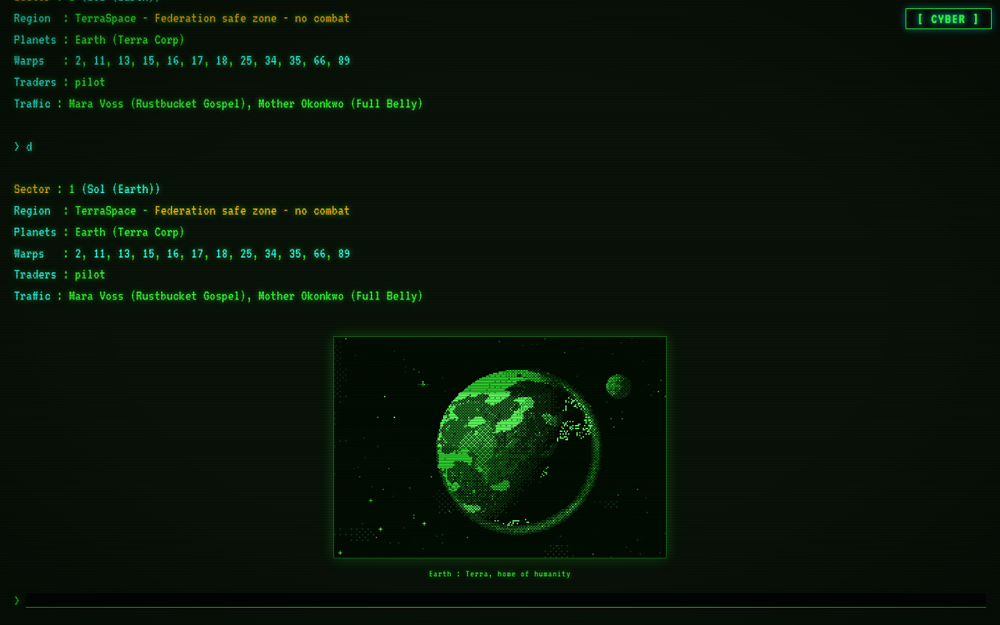

**On a phone.** Login, cyber mode, an alien homeworld and BBS mode with the tap keypad.

<p>
  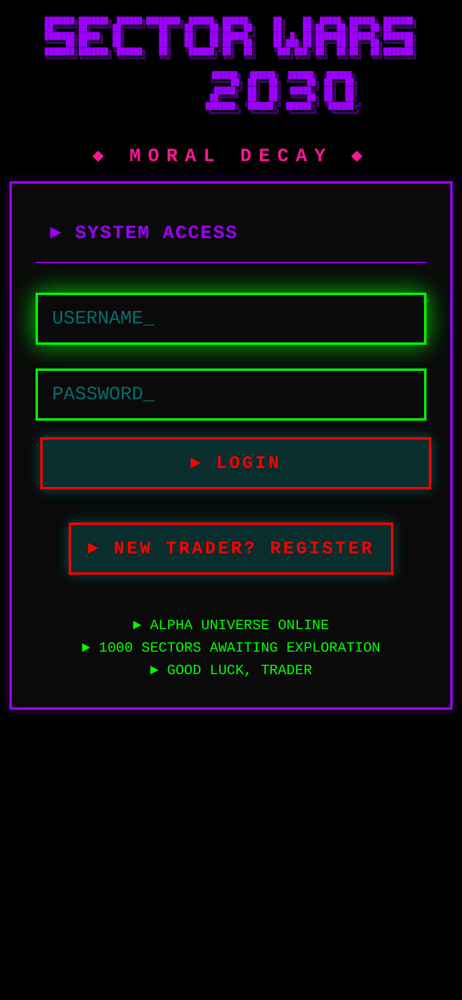
  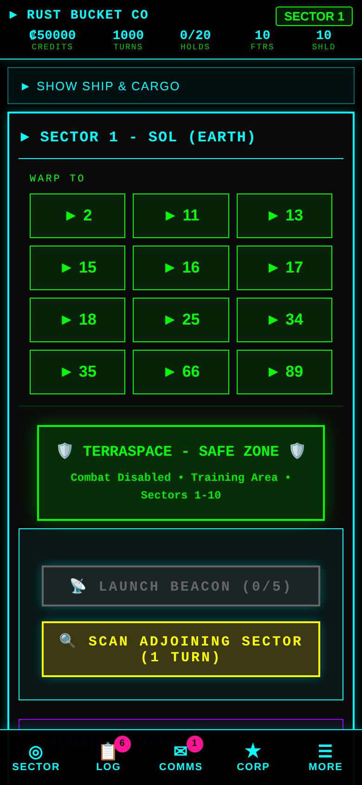
  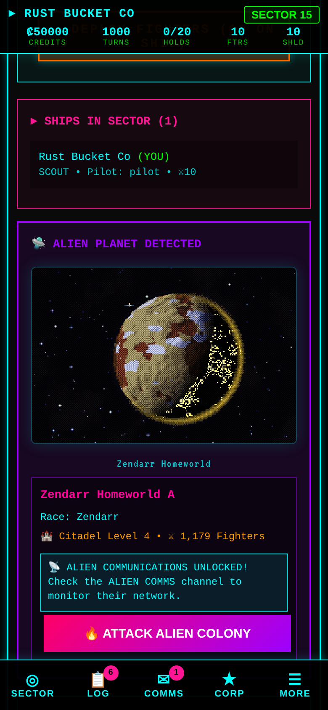
  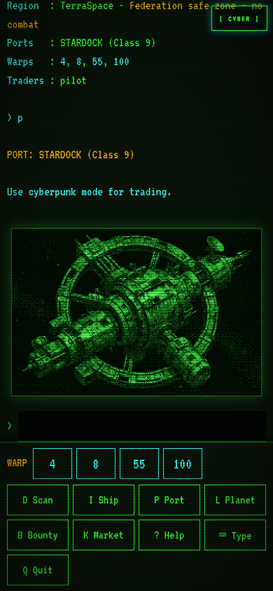
</p>

**Admin panel.** Set up universes and seasons without touching SQL.

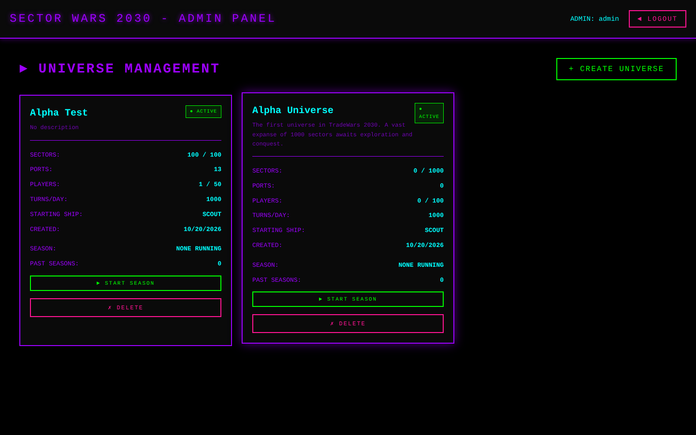

## Architecture

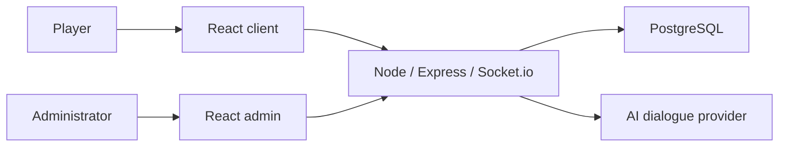

## Project Structure

```
tradewars2030/
├── client/          # Player frontend (React + Vite + TypeScript)
├── admin/           # Admin panel (React + Vite + TypeScript)
├── server/          # Backend API (Node.js + Express + TypeScript)
└── shared/          # Shared TypeScript types and constants
```

## Tech Stack

### Frontend (Client & Admin)
- **React 19**: UI framework
- **TypeScript**: Type safety
- **Vite**: Build tool and dev server
- **CSS**: Cyberpunk-themed styling with ASCII art

### Backend (Server)
- **Node.js + Express**: REST API server
- **TypeScript**: Type-safe backend code
- **Socket.io**: Real-time WebSocket communication
- **PostgreSQL**: Robust relational database
- **JWT**: Authentication
- **bcrypt**: Password hashing

## Getting Started

### Prerequisites
- Node.js 18+
- PostgreSQL 14+
- npm or yarn

### Database Setup

1. Create the PostgreSQL database:
```bash
createdb tradewars
```

2. Run the schema:
```bash
cd server
psql tradewars < src/db/schema.sql
```

3. Configure environment:
```bash
cp server/.env.example server/.env
# Edit server/.env with your database credentials
```

### Server Setup

```bash
cd server
npm install
npm run dev
```

Server runs on http://localhost:3000

### Client Setup

```bash
cd client
npm install
npm run dev
```

Client runs on http://localhost:5173

### Admin Panel Setup

```bash
cd admin
npm install
npm run dev
```

Admin panel runs on http://localhost:5174

## Database Schema

### Core Tables
- **users**: Player accounts and authentication
- **universes**: Game universe configurations
- **players**: Player game state (ships, cargo, credits, turns)
- **sectors**: Universe sectors with ports and connections
- **sector_warps**: Warp connections between sectors
- **planets**: Player-owned planets
- **ship_types**: Available ship configurations
- **corporations**: Team/alliance system
- **game_events**: Historical event log
- **combat_log**: Combat history
- **alien_planets**: Alien planet locations and details
- **alien_ships**: Alien ship configurations and positions
- **alien_communications**: Alien message history
- **player_alien_unlocks**: Tracks which players have unlocked alien comms

See [server/src/db/schema.sql](server/src/db/schema.sql) for complete schema.

## Game Features

### Core Game Mechanics
- **Turn-based gameplay**: Limited turns per day with automatic regeneration
- **Turn regeneration**: Turns restore gradually over time (turns_per_day / 24 per hour)
- **Space trading**: Buy/sell fuel, organics, equipment at ports
- **Port types**: 8 port configurations for strategic trading routes
- **Player-to-player trading**: Make trade offers to other pilots, with a 25% robbery gamble for the bold (failed robberies trigger combat)
- **Ship progression**: 10 ships from Escape Pod to Dreadnought
- **TW2002-style warp ranges**: Constrained warp destinations (±50-200 sectors) create natural trade routes and strategic territory
- **Warp drive misfire**: 0.25% chance of malfunction sending you to a random sector
- **TerraSpace safe zone**: Protected starting area (2% of universe, minimum 10 sectors) where aggressive aliens cannot enter
- **Plot Course**: Auto-navigation with smart pause at points of interest
- **Ship communications**: Direct messages, broadcasts, and corporate chat
- **Combat system**: Attack players and aliens (1 turn, 75% loot, 25% death penalty)
- **Planets**: ~30 claimable planets per universe, colonize and produce resources
  - Earth (Sol, Sector 1) and Mars (last TerraSpace sector) owned by Terra Corp
  - Citadel defense system (6 levels with production bonuses)
  - Resource production based on colonist population
  - Fighter deployment and credit treasury
- **Banking System**: StarDock-based banking with personal and corporate accounts
  - 5% withdrawal fee, 25% bank balance lost on death
  - Corporate withdrawal limits by rank
- **Alien System**: NPC adversaries with AI behaviors
  - Alien planets scale with universe size (0.3% formula for 1000+ sectors)
  - Alien ships with balanced behavior distribution (40% trade, 30% patrol, 20% aggressive, 10% defensive)
  - Alignment system affects alien interactions: traders are friendly, raiders are hostile
  - TerraSpace protection: aggressive/patrol/defensive aliens cannot enter, but trade aliens can
  - Alien communications channel (read-only), unlocked after visiting an alien planet
  - Alien ships move and attack automatically via game tick system
  - Combat with aliens for credits and cargo (strategic choice: attack traders or build relationships)
- **Corporations**: Form alliances with other players
  - Ranks: Founder, Officer, Member
  - Invite system, kick members, promote/demote
  - Corporate chat channel for alliance coordination
- **Territory control**: Deploy fighters and mines
  - Fighter maintenance: ₡5/fighter/day
  - Mines: ₡10,000 each, 75-225 damage per explosion
  - Beacons: Personal markers with custom messages
- **Genesis Torpedoes**: Create new planets anywhere (₡50,000 each)
- **Ship Log**: Auto-logging of discoveries (ports, planets, StarDocks, dead-ends)
- **Dynamic events**: The universe acts on its own: ion storms that scramble warps (misfires, extra turns, failed jumps, salvage on entry), alien incursions you can fight for alien salvage and hunter leaderboard credit, and port strikes that close a port and push demand prices up at neighbouring ports. Everything is forecast on TNN first, never targets TerraSpace, max two at a time
- **NPC trader traffic**: Eight named independent traders per universe warp between ports and trade small amounts through the living economy, so stock and prices move even with no players online. Hail them in sector for market tips drawn from live prices
- **Seasons and Hall of Fame**: 30 day competitive seasons run per universe. Standings track net worth, experience, kills and planets while the season runs, TNN warns everyone before the end, and the final standings are archived in a Hall of Fame when the season closes. Ending a season never touches your ship, cargo, credits or planets
- **Smuggling**: Three contraband goods (Banned Tech Components, Restricted Medical Compounds, Stolen Artifacts) that legal ports refuse to touch. Black markets open at ports on the economy tick and quote prices as of the last tick, so the price you saw before arriving can move. Customs patrols sweep sectors outside TerraSpace and scan holds for contraband; get caught and the cargo is seized, you pay a fine, and the seized goods are auctioned off legally at the port of seizure. Repeat confiscations earn a visible flagged marker other players can see, and cleared derelicts make good stash spots for hiding contraband between runs

### Modern Enhancements
- **Web-based interface**: Accessible from any browser
- **Real-time updates**: See other players' actions via WebSockets
  - Player movement, combat, trading, planet colonization
  - Alien encounters and communications
  - Genesis torpedo launches, beacon messages
- **Cyberpunk aesthetics**: Neon colors and ASCII art
- **Admin panel**: Configure universes without SQL

## Port Types

Each letter represents commodity availability:
- **B** = Buying (port buys from you)
- **S** = Selling (port sells to you)

Format: `[Fuel][Organics][Equipment]`

- **BBS**: Buys Fuel, Buys Organics, Sells Equipment
- **BSB**: Buys Fuel, Sells Organics, Buys Equipment
- **SBB**: Sells Fuel, Buys Organics, Buys Equipment
- **SSB**: Sells Fuel, Sells Organics, Buys Equipment
- **SBS**: Sells Fuel, Buys Organics, Sells Equipment
- **BSS**: Buys Fuel, Sells Organics, Sells Equipment
- **SSS**: Sells all commodities (rare)
- **BBB**: Buys all commodities (rare)

## Development Roadmap

### Completed ✅
- [x] Project structure setup
- [x] Database schema design and migrations
- [x] Server initialization
- [x] Shared TypeScript types
- [x] Authentication system (JWT + bcrypt)
- [x] User registration and login API
- [x] Admin authorization middleware
- [x] Universe generation service (with ~3% planets, 12% ports)
- [x] Ship types system
- [x] **Admin Panel (Port 5174)**
  - [x] Purple cyberpunk theme
  - [x] Universe creation UI with defaults
  - [x] Universe management dashboard
  - [x] Toggle slider for dead-end sectors
- [x] **Player Initialization System**
  - [x] Player creation API
  - [x] Starting ship assignment
  - [x] Credits and sector placement
  - [x] Reserved corporation names (Terra Corp)
- [x] **Sector Navigation System**
  - [x] GET /api/sectors/:sectorNumber: sector details with warps
  - [x] POST /api/sectors/move: move player between sectors
  - [x] Turn consumption (1 turn per move)
  - [x] Bidirectional warp connections
  - [x] SectorView component with ASCII art
  - [x] Warp drive misfire system (0.25% chance of malfunction)
  - [x] Visited sector tracking with visual indicators
  - [x] Previous sector navigation (◄ marker)
- [x] **Port Trading System**
  - [x] GET /api/ports/:sectorNumber: port details and prices
  - [x] POST /api/ports/trade: buy/sell commodities
  - [x] Dynamic pricing based on port percentage
  - [x] PortTradingPanel with cyberpunk UI
  - [x] Cargo manifest display
- [x] **Turn Regeneration System**
  - [x] Gradual turn regeneration (turns_per_day / 24 per hour)
  - [x] Automatic regeneration on player data fetch
  - [x] Capped at universe's turns_per_day setting
- [x] **Ship Communications System**
  - [x] Send messages to other ships in your sector
  - [x] Messages stored in "ship computer" for offline players
  - [x] Inbox/Sent message views
  - [x] Unread message count badge
  - [x] Reply and delete functionality
- [x] **Automated Testing**
  - [x] Jest + ts-jest framework
  - [x] 17 tests total (navigation, player creation, banking, combat)
  - [x] Run with: `cd server && npm test`
- [x] **Economy & Combat Rebalancing (2025-12-02)**
  - [x] Banking system fixes (StarDock requirement, 5% withdrawal fee, death penalty on bank balance)
  - [x] Combat improvements (1 turn cost, 75% loot, 25% death penalty)
  - [x] Fighter maintenance system (₡5/fighter/day, auto-destruction on non-payment)
  - [x] Planet production buff (5x rates, citadel bonuses)
  - [x] Corporate account withdrawal limits (founder/officer/member tiers)
  - [x] Ship cost database fixes
- [x] **UI Improvements**
  - [x] No browser popups (prompt/alert/confirm). All interactions use UI modals
  - [x] Real-time ship status updates (fighters update immediately on deploy/retrieve)
  - [x] Fighter maintenance cost warnings in deployment UI
- [x] **Alien System (2025-12-02, updated 2026-01-12)**
  - [x] Alien planet generation with scaling formula (0.3% for 1000+ sectors)
  - [x] Alien ship generation with multiple races and ship types
  - [x] Alien communications channel (read-only)
  - [x] Auto-unlock alien comms when entering alien planet sector
  - [x] Alien comms integrated into MessagingPanel as separate tab
  - [x] Alien ship AI movement system (game tick every 5 minutes)
  - [x] Alien ship behaviors with balanced distribution (40% trade, 30% patrol, 20% aggressive, 10% defensive)
  - [x] Alien alignment system: traders friendly (+50 to +150), patrol neutral (-50 to +50), raiders hostile (-300 to -150), guards territorial (-100)
  - [x] Alien planet detection and logging in ship log
  - [x] Admin panel configuration for alien planet count
- [x] **TW2002-Style Universe Generation (2026-01-12, updated 2026-01-13)**
  - [x] Constrained warp ranges (±50-200 sectors) instead of fully random
  - [x] Dynamic TerraSpace sizing (2% of universe, minimum 10 sectors)
  - [x] TerraSpace exit sectors use constrained ranges (no long-distance teleports)
  - [x] Mars planet at last TerraSpace sector (owned by Terra Corp)
  - [x] Alien TerraSpace restrictions (trade aliens can enter, aggressive/patrol/defensive cannot)
  - [x] Alien spawning respects dynamic TerraSpace boundaries
  - [x] Dynamic connection limits: edge sectors max 6, middle sectors max 8 (allows natural hub formation)
  - [x] Connectivity verification from actual inserted warps (prevents isolated sectors)
  - [x] Automatic connection of unreachable sectors during universe generation
- [x] **Dynamic Events & NPC Traffic (2026-10-19)**
  - [x] Ion storms, alien incursions, and port strikes on a 5-minute event tick with TNN forecasts
  - [x] Event banner in sector view, incursion engage button, port strike notice, BBS terminal event lines
  - [x] Admin event endpoints: history, force start, force resolve, seeding cooldown
  - [x] Named NPC traders moving and trading between ports; hails return live market tips
- [x] **Seasons & Hall of Fame (2026-10-20)**
  - [x] 30 day timed seasons per universe, one active at a time (migration 034)
  - [x] Live standings in rankings, BBS mode, and the admin panel
  - [x] TNN end of season warnings at 7 days, 24 hours, and 1 hour out
  - [x] Final standings archived to the Hall of Fame at season end; player ships, cargo, credits, and planets are never wiped
- [x] **Smuggling (2026-10-22)**
  - [x] Three contraband goods traded only at black markets that open at ports on the 5-minute tick, with prices snapshotted at the last tick (migration 035)
  - [x] Customs patrols with cargo scans outside TerraSpace; ion storms and nearby incursions lower scan odds
  - [x] Confiscation: contraband seized, fine capped at credits on hand, seized goods auctioned at the port of seizure
  - [x] Repeat offenders flagged for 48 hours with a visible marker and a notice to the player; contraband stashes on cleared derelicts
  - [x] Admin patrol controls: force spawn, force clear, scan tuning, and a smuggling event log

### In Progress 🚧
- [ ] Mobile responsive design improvements
- [ ] Advanced admin tools (player management)

## Running Tests

```bash
cd server
npm test              # Run all tests
npm run test:watch    # Watch mode
npm run test:coverage # With coverage report
```

## Documentation

- **PROJECT_STATUS.md**: Detailed development status and session context
- **MANUAL_TESTING_GUIDE.md**: Comprehensive manual testing procedures
- **server/DATABASE_SETUP.md**: Database configuration guide

## License

MIT

## Credits

Inspired by TradeWars 2002 by Gary Martin, the legendary BBS space trading game that defined the genre.
